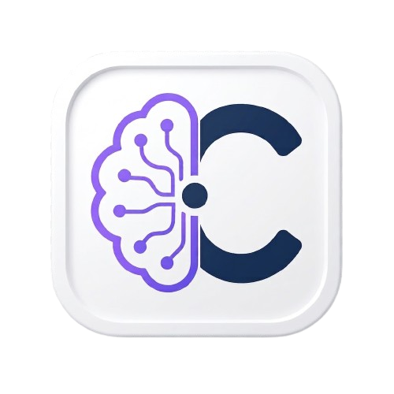
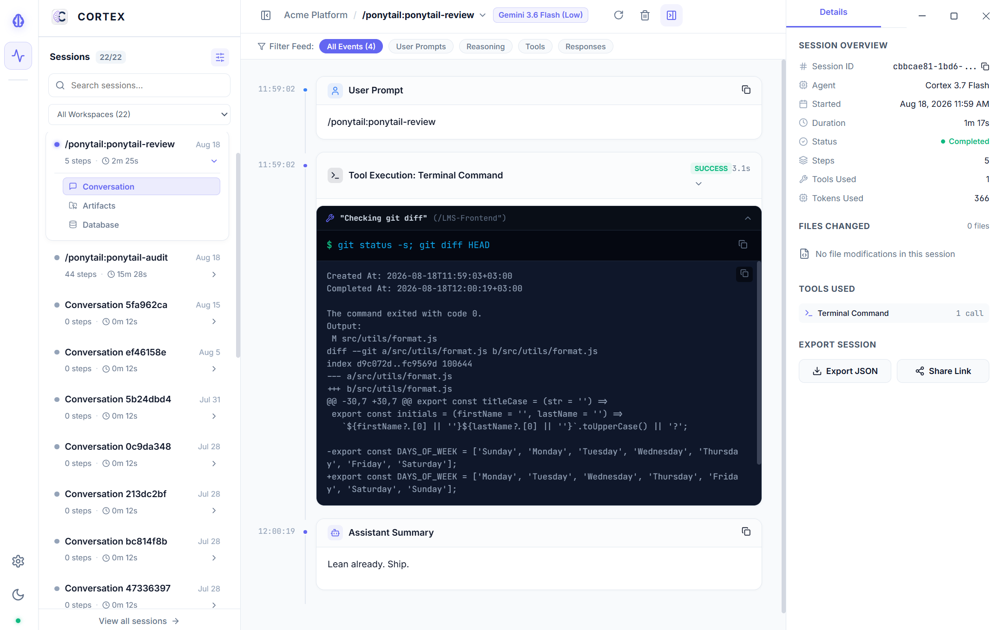

# 🧠 Cortex

<p align="center">
  
</p>

<p align="center">
  <strong>Real-time observability dashboard & local developer HUD for Google Antigravity IDE agent sessions, reasoning traces, tool executions, and runtime artifacts.</strong>
</p>

<p align="center">
  <a href="https://github.com/yibeltal-gashaw/cortex"></a>
  <a href="https://nodejs.org"></a>
  <a href="https://react.dev"></a>
  <a href="https://www.electronjs.org"></a>
  <a href="#-windows-desktop-app"></a>

</p>

<p align="center">
  
</p>

---

## 📖 Overview

**Cortex** is an observability tool and developer inspector built specifically for developers using the **Google Antigravity IDE**. It connects directly to your local Antigravity runtime workspace to stream, parse, and visualize the complete execution lifecycle of autonomous AI coding agents in real-time.

Instead of parsing raw JSONL files or losing context across sessions, Cortex provides a modern multi-pane HUD to inspect model reasoning, terminal commands, file diffs, SQLite cache databases, and generated project artifacts.

---

## ✨ Features

### 🔍 Chronological Execution Timeline
- **Granular Filter Tabs:** Filter steps by *All*, *User Requests*, *Thinking*, *Tool Executions*, or *Responses*.
- **Model Reasoning Accordion:** Collapsible chain-of-thought inspector with markdown rendering and word-count metrics.
- **Terminal Execution Blocks:** Inspect `run_command` invocations with working directory (CWD), live stdout/stderr streams, status badges, and one-click copy.
- **Split & Unified File Diffs:** Visual before/after diff viewer with highlighted line additions and deletions for file modification tools (`replace_file_content`, `write_to_file`).
- **Web & Tool Inspections:** Inspect `search_web` queries, fetched web markdown (`read_url_content`), and file reads (`view_file`).

### 📂 Artifacts & Planning Explorer
- **Interactive File Tree:** Explore the complete `brain/<conversation-id>/` directory structure.
- **Rendered Markdown Viewer:** View rendered `implementation_plan.md` and `walkthrough.md` specifications with alerts and tables.
- **Task Log Streamer:** Monitor background task logs (`task-*.log`) and subagent execution streams.
- **Image Lightbox:** Preview generated UI screenshots and uploaded assets with lightbox zoom.

### 🗄️ Native SQLite Database Inspector
- **Native Node.js 24 SQLite Driver:** Zero-dependency SQLite inspection powered directly by `node:sqlite` (`DatabaseSync`).
- **Schema & Tables Explorer:** Inspect table column definitions, data types, and primary keys for `conversations/<id>.db`.
- **Paginated Data Grid:** Browse rows, search records, and inspect binary BLOBs with hex dump and ASCII previews.

### 🧭 Session Management & Workspace Filtering
- **Multi-Workspace Filtering:** Automatically detects project roots from prompt metadata to organize sessions by workspace.
- **Fuzzy Full-Text Search:** Instant search across prompts, UUIDs, tool names, and code snippets.
- **Environment Snapshot:** Real-time visibility into active files, cursor lines, open editor tabs, and running background commands with runtimes.
- **Safe Permanent Deletion:** Two-step confirmation modal requiring typing `DELETE` to safely purge cached session data and SQLite databases.

### 🎨 Modern HUD Design System
- **Light & Dark Themes:** Built-in high-contrast dark theme and clean light theme with instant switching.
- **Responsive Multi-Pane Layout:** Collapsible sessions drawer, central activity stage, and collapsible telemetry inspector.
- **Windows & Desktop Ready:** Runs as a lightweight web dashboard or a standalone Windows desktop app (NSIS setup installer and portable `.exe`) with an embedded server and custom theme-matched titlebar.

---

## 🏗️ Architecture

Cortex connects directly to your local Antigravity IDE storage directory:
- **Windows:** `%USERPROFILE%\.gemini\antigravity-ide`
- **macOS / Linux:** `~/.gemini/antigravity-ide`

```text
~/.gemini/antigravity-ide/
├── brain/
│   └── <conversation-id>/
│       ├── .system_generated/
│       │   ├── logs/
│       │   │   ├── transcript.jsonl        <-- Step-by-step stream parsed by Cortex
│       │   │   └── transcript_full.jsonl   <-- Untruncated full logs
│       │   └── tasks/                      <-- Background task output logs
│       ├── implementation_plan.md          <-- Rendered in Artifacts view
│       └── walkthrough.md                  <-- Verification walkthroughs
└── conversations/
    └── <conversation-id>.db                <-- Explored via Native SQLite engine
```

---

## ⚡ Quick Start

### Prerequisites
- **Node.js:** `v20.x` or higher (Recommended: `Node.js v24+` for native `node:sqlite` features)
- **npm:** `v9+`

### 1. Clone the Repository
```bash
git clone https://github.com/yibeltal-gashaw/cortex.git
cd cortex
```

### 2. Install Dependencies
```bash
npm run install:all
```

### 3. Launch Development Mode
```bash
npm run dev
```